<div align="center">

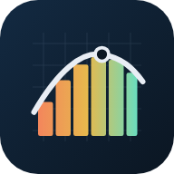

# 📐 Slices — Calculus 1 · 2 · 3, *live*

**15 interactive, animated labs that turn calculus into something you can grab, drag and spin.**
From limits to Stokes' theorem — every graph moves, every answer is checked, every topic levels you up.

[](https://jaineil32624.github.io/Slices/)
[](https://github.com/jaineil32624/Slices/releases/latest/download/Slices.apk)
[](https://github.com/jaineil32624/Slices/releases/latest)


-ff8b5e)

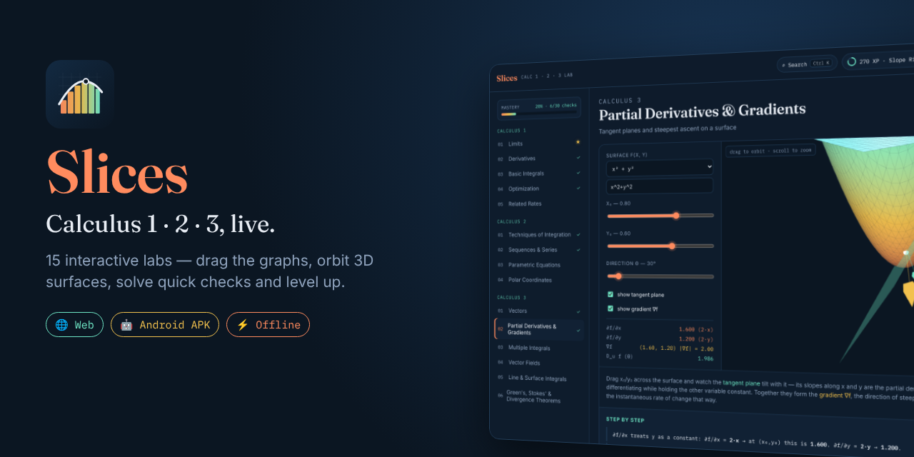

</div>

---

## ✨ What's inside

<table>
<tr>
<td width="33%" valign="top">

### 🟠 Calculus 1
- 🎯 **Limits** — both sides converge
- 📈 **Derivatives** — secant → tangent
- 🟧 **Basic Integrals** — Riemann rectangles
- ⛰️ **Optimization** — peaks & valleys
- 🪜 **Related Rates** — the sliding ladder

</td>
<td width="33%" valign="top">

### 🟡 Calculus 2
- 🧩 **Techniques of Integration** — u-sub, parts, trig
- ➿ **Sequences & Series** — partial sums & ratio test
- 🌀 **Parametric Equations** — tangent vectors
- 🌸 **Polar Coordinates** — roses, cardioids & area

</td>
<td width="33%" valign="top">

### 🟢 Calculus 3
- ➡️ **Vectors** — dot & cross products *(3D)*
- 🏔️ **Partial Derivatives & Gradients** *(3D)*
- 🧊 **Multiple Integrals** — prism sums *(3D)*
- 🌪️ **Vector Fields** — divergence & curl
- 〰️ **Line & Surface Integrals**
- 🏛️ **Green's, Stokes' & Divergence**

</td>
</tr>
</table>

## 🎮 Make it interactive

| | Feature | What it does |
|---|---|---|
| ✋ | **Drag the graph** | Grab the plot itself to move x₀, the integral bounds, the ladder or the probe point |
| 🎯 | **Live coordinates** | Hover any 2D plot for a crosshair with exact `(x, y)` |
| ⚡ | **Quick checks** | 30 questions (2 per topic) with instant feedback, explanations and confetti 🎉 |
| 🏆 | **XP & levels** | Earn XP for exploring and solving — climb from *Curious* to *Flux Master* |
| ★ | **Mastery tracker** | Sidebar ✓ / ★ marks and a progress bar, saved on your device |
| 🔍 | **Command palette** | `Ctrl K` or `/` to jump to any topic instantly |
| ⌨️ | **Keyboard** | `←` `→` flip topics · `1`–`4` answer · `F` fullscreen · `M` music · `?` help |
| 🧭 | **3D controls** | Drag to orbit, pinch / scroll to zoom, ⟳ auto-rotate, ⌂ reset |
| ⤢ | **Fullscreen** | Blow any visual up to the whole screen — great for presenting |
| 📷 | **Save image** | Export the current graph or 3D surface as a PNG |
| 🔗 | **Share links** | Every topic has its own URL (e.g. `#der`, `#vf`) |
| 🧮 | **Symbolic engine** | Hand-written parser + differentiator — type your own functions, no `eval()` |
| 🎵 | **Music** | Optional lo-fi background track |

## 📸 Screenshots

<table>
<tr>
<td>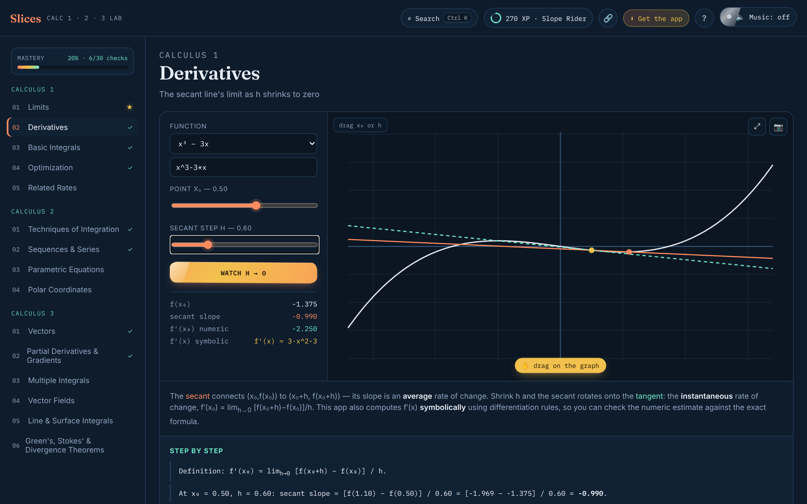<p align="center">📈 <b>Derivatives</b> — secant vs tangent, symbolic f′(x)</p></td>
<td>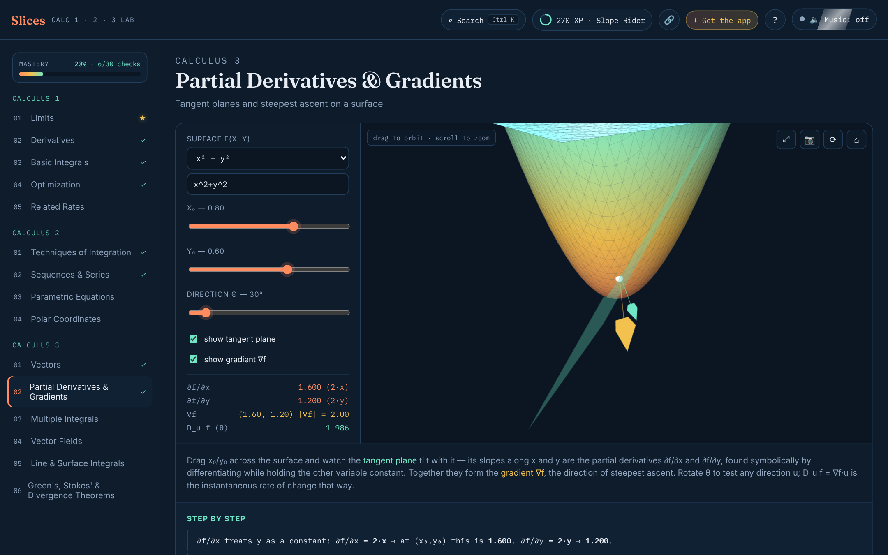<p align="center">🏔️ <b>Gradients</b> — tangent plane on a 3D surface</p></td>
</tr>
<tr>
<td>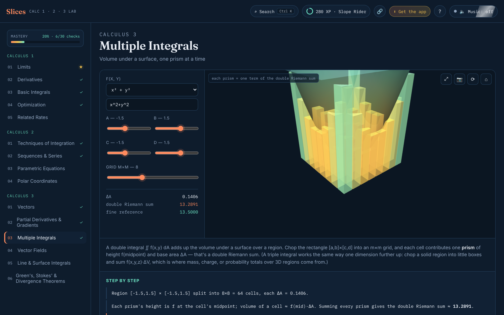<p align="center">🧊 <b>Multiple Integrals</b> — volume as prisms</p></td>
<td>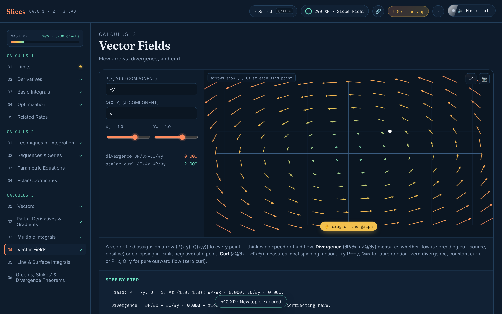<p align="center">🌪️ <b>Vector Fields</b> — divergence & curl</p></td>
</tr>
<tr>
<td>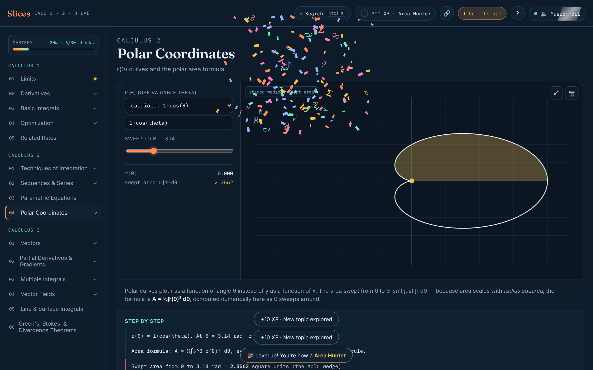<p align="center">🌸 <b>Polar Coordinates</b></p></td>
<td>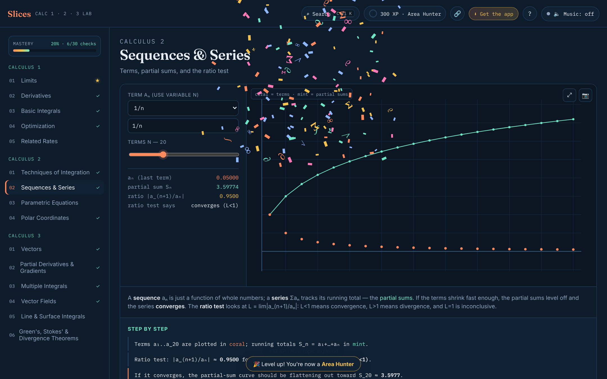<p align="center">➿ <b>Sequences & Series</b></p></td>
</tr>
<tr>
<td>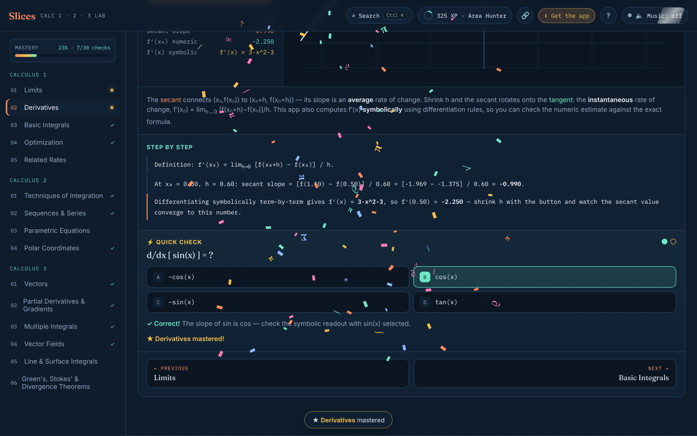<p align="center">⚡ <b>Quick checks</b> with XP</p></td>
<td>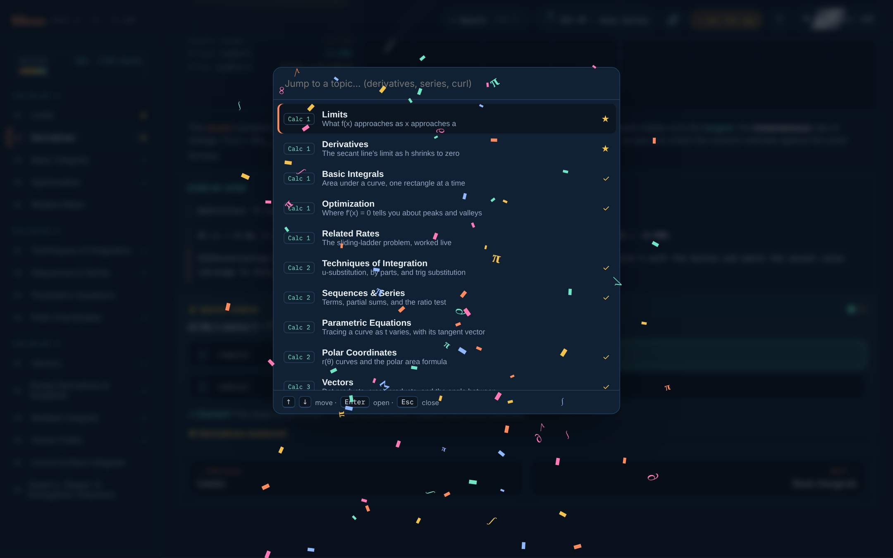<p align="center">🔍 <b>Ctrl K</b> topic search</p></td>
</tr>
</table>

<p align="center">
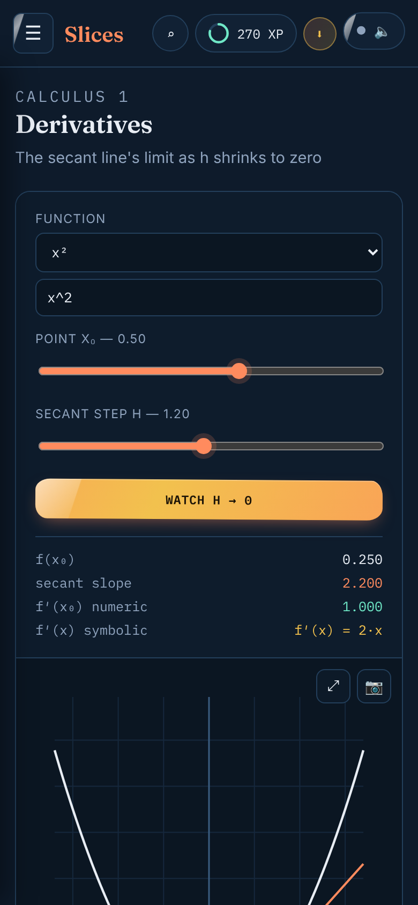
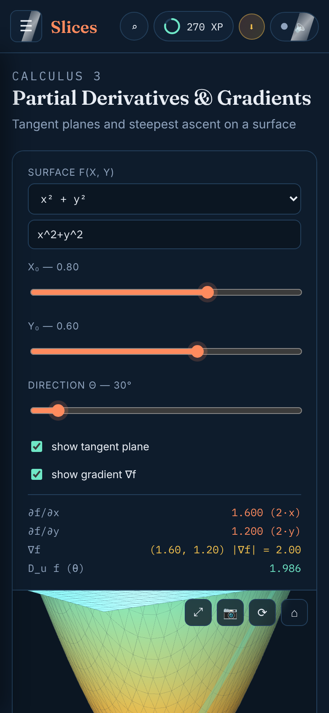
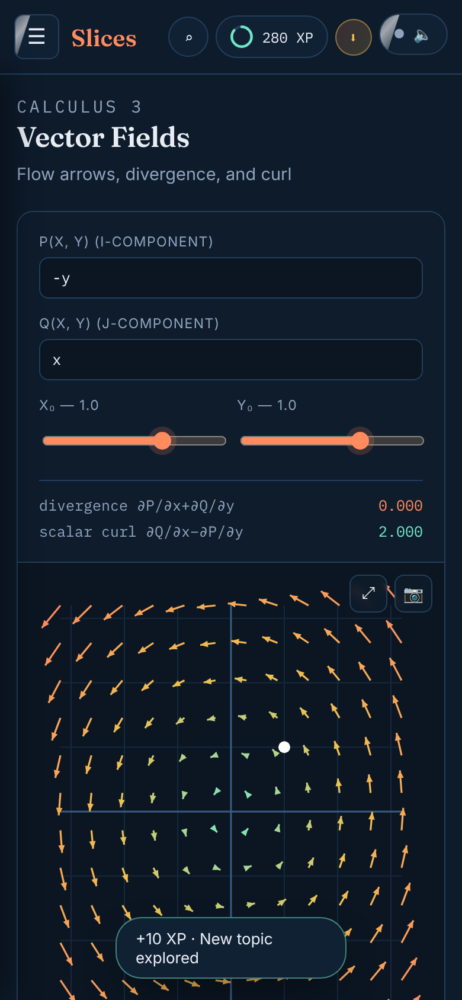
<br><em>📱 Fully touch-friendly on phones & tablets</em>
</p>

## 📥 Get Slices

| Platform | How |
|---|---|
| 🌐 **Web** | Open **[jaineil32624.github.io/Slices](https://jaineil32624.github.io/Slices/)** — nothing to install |
| 🤖 **Android** | Download **[Slices.apk](https://github.com/jaineil32624/Slices/releases/latest/download/Slices.apk)** → open it → allow *Install unknown apps* if asked |
| 💻 **Windows / Mac / Chromebook** | Open the website in Chrome or Edge → click **⬇ Get the app** → **Install** |
| 🍎 **iPhone / iPad** | Open the website in Safari → **Share** → **Add to Home Screen** |
| 📦 **Offline zip** | Grab **Slices-web.zip** from [Releases](https://github.com/jaineil32624/Slices/releases/latest), unzip, open `index.html` |

> 💡 Once installed, Slices works **100% offline** — no account, no ads, no tracking. Progress is saved only on your device.

<p align="center"></p>

## 🛠️ Run it locally

```bash
git clone https://github.com/jaineil32624/Slices.git
cd Slices
python3 -m http.server 8000      # then open http://localhost:8000
```

No build step and no dependencies to install — it's plain HTML, CSS and JavaScript.

## 🗂️ Project structure

```
Slices/
├── index.html              🧱 page shell, PWA + social meta
├── styles.css              🎨 design tokens + the liquid button system
├── app.js                  🧠 parser, symbolic derivatives, 2D/3D rendering, 15 modules
├── extras.js               ⚡ quizzes, XP, palette, drag-on-graph, share, install
├── extras.css              💅 styles for the interactive layer
├── sw.js                   📴 offline service worker
├── manifest.webmanifest    📲 installable-app manifest
├── icons/                  🖼️ app icons (SVG + PNG + maskable)
├── vendor/                 📦 Three.js + fonts, bundled for offline use
├── docs/screenshots/       📸 images used in this README
└── .github/workflows/
    ├── release.yml         🤖 builds the Android APK + publishes a Release
    └── vendor.yml          ⬇️ refreshes the offline vendor files
```

## 🚀 Releasing a new version

Push a version tag and GitHub Actions builds the APK and publishes the release automatically:

```bash
git tag v1.1.0 && git push origin v1.1.0
```

## ➕ Adding a new topic

Each module is one object pushed into the `MODULES` array in `app.js` (search for **MODULE IMPLEMENTATIONS**). Copy an existing one — it needs `controlsHTML`, `explainHTML` and an `init(panel)` function — then add two questions for it to the `QUIZ` bank in `extras.js`.

---

<div align="center">

Made with ☕, 📐 and way too many derivatives by **[Jaineil Rana](https://github.com/jaineil32624)**

⭐ *If Slices helped calculus click, give it a star!* ⭐

</div>
